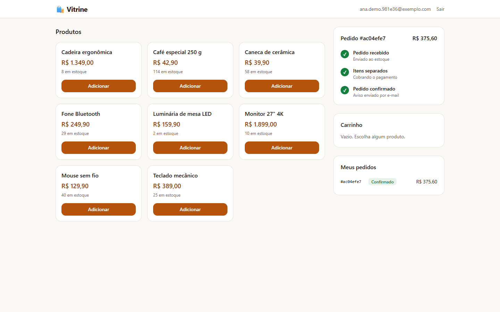
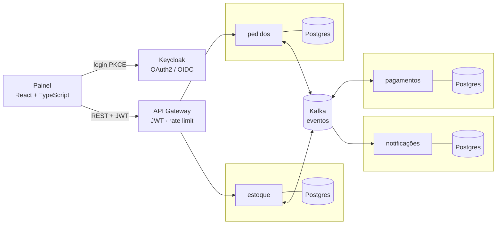
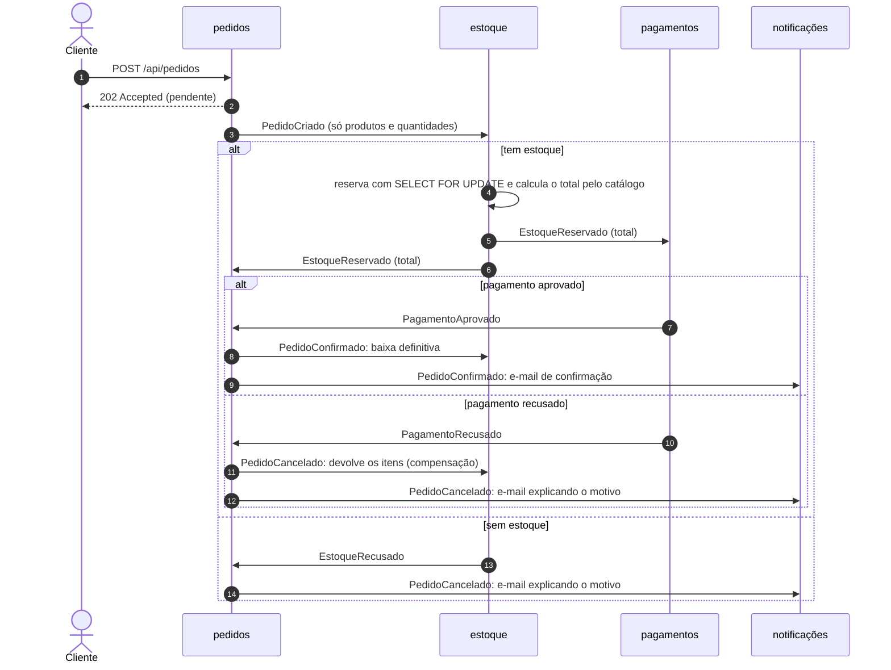
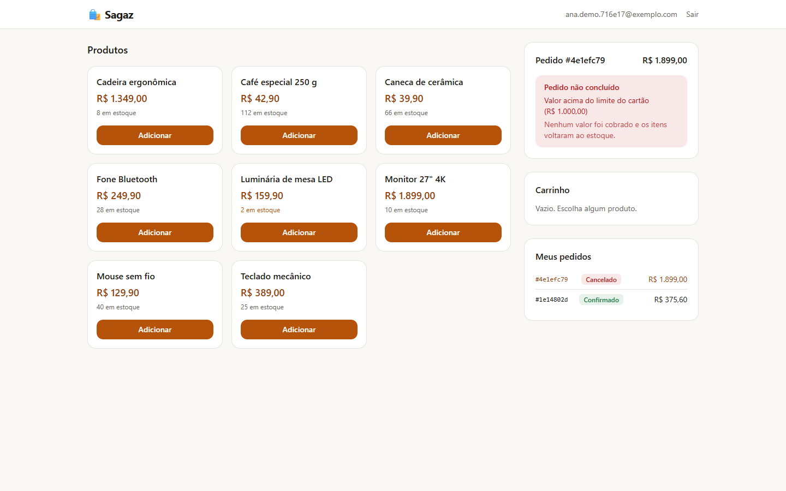
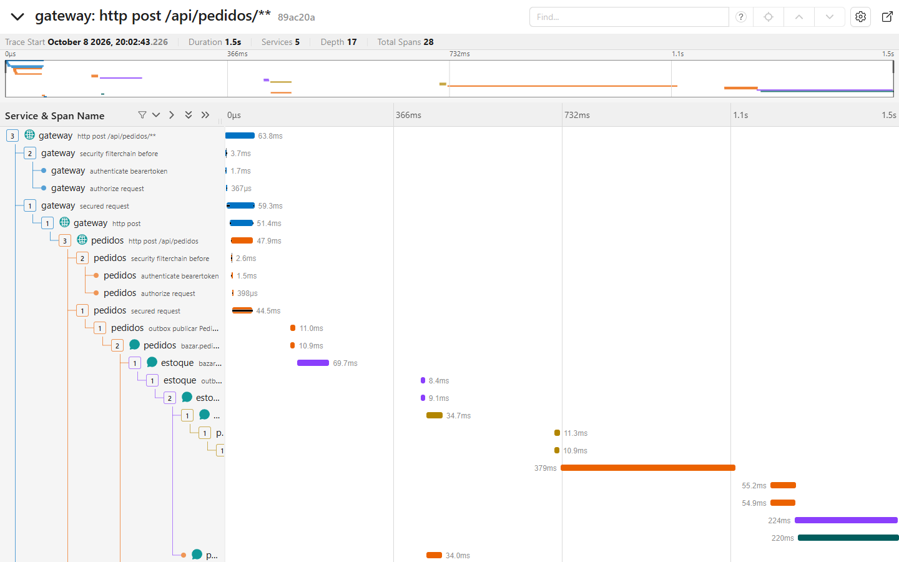
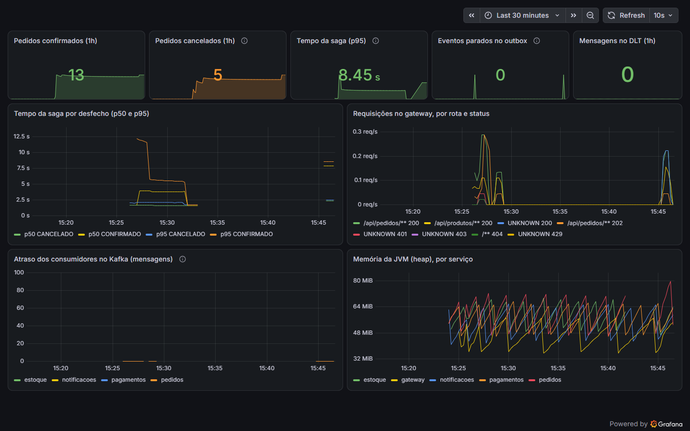
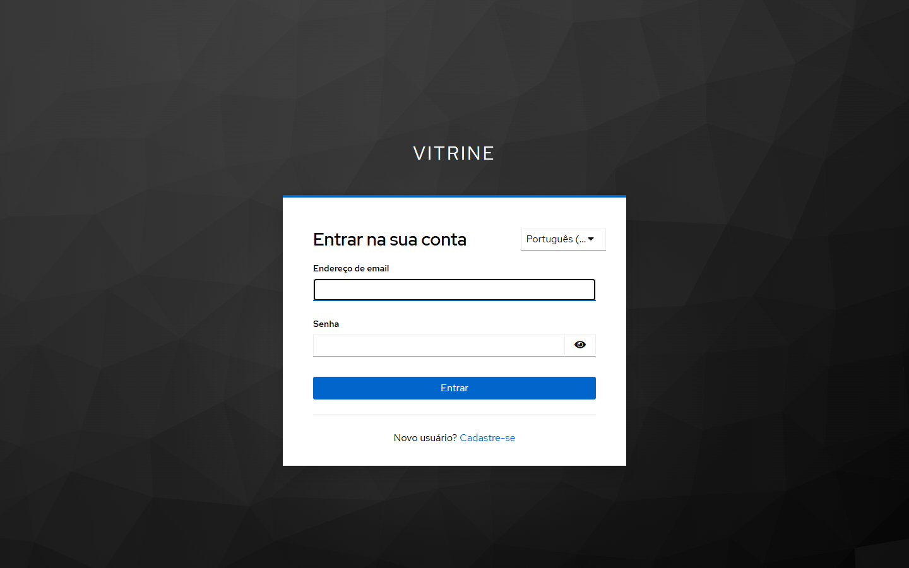
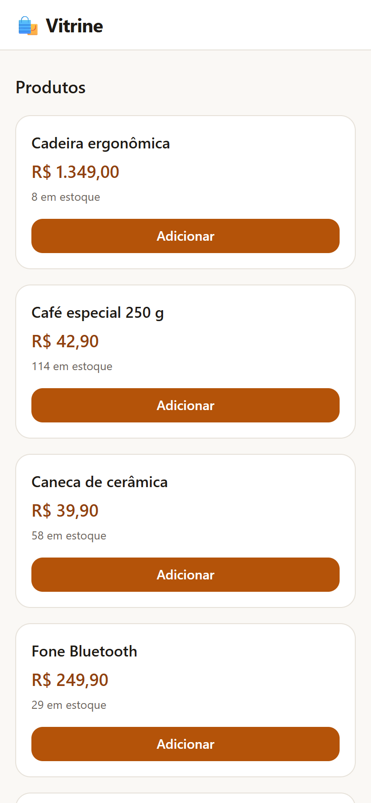

<h1 align="center">🛍️ Bazar</h1>

<p align="center">
  <b>Uma loja feita de microsserviços que conversam por eventos.</b><br>
  Cada pedido atravessa estoque, pagamento e aviso por e-mail numa <b>saga com compensação</b>:<br>
  se um passo falha, os anteriores são desfeitos, sem transação distribuída e sem cobrar duas vezes.
</p>

<p align="center">
  <a href="../../actions/workflows/ci.yml"></a>
  
  
  
  
  
  
  
  
  
  
</p>

<p align="center">
  
</p>

---

## 🎯 O problema

Numa loja feita como um sistema só, comprar é uma transação no banco: reserva o estoque, cobra o cartão e, se algo falhar, o banco desfaz tudo.

Com **microsserviços**, cada serviço tem o próprio banco, e não existe transação que atravesse os quatro. Se o pagamento for recusado *depois* de o estoque ter sido reservado, alguém precisa devolver os itens. Se o serviço cair entre gravar o pedido e avisar os outros, o pedido fica perdido. Se a mesma mensagem chegar duas vezes, o cliente não pode ser cobrado duas vezes.

O Bazar resolve esses problemas com os padrões usados em sistemas distribuídos de verdade: **saga coreografada com compensação**, **Transactional Outbox**, **consumo idempotente** e **Dead Letter Topic**. E mostra tudo funcionando: cada pedido aparece no painel andando etapa por etapa e vira um *trace* que atravessa os cinco serviços.

## ⚙️ Como funciona



Nenhum serviço chama outro diretamente: eles só publicam e consomem eventos no Kafka. Cada um tem o próprio banco e o próprio usuário de banco. O caminho de um pedido:



O serviço de pagamentos simula uma operadora: aprova compras de até R$ 1.000,00 e recusa as maiores, o que permite ver a compensação acontecer.

<p align="center">
  
</p>

## 🧱 Stack

| Área | Tecnologias |
|---|---|
| ⚙️ **Back-end** | Java 25 · Spring Boot 4 · Spring Cloud Gateway · Spring Data JPA · Flyway · PostgreSQL 18 · Bean Validation |
| 📨 **Mensageria** | Apache Kafka 4 (KRaft, sem ZooKeeper) · Spring Kafka · saga coreografada · Transactional Outbox · consumo idempotente · Dead Letter Topic |
| 🔐 **Segurança** | Keycloak 26 · OAuth2 / OpenID Connect · PKCE · JWT (emissor e audiência) · rate limiting (Bucket4j) · CSP rígida |
| 🎨 **Front-end** | React 19 · TypeScript 7 · Vite 8 · Tailwind CSS 4 · oidc-client-ts · nginx sem root |
| 📈 **Observabilidade** | OpenTelemetry · Jaeger · Micrometer · Prometheus · Grafana (painel como código) · alertas |
| ✅ **Qualidade** | JUnit 5 · Testcontainers (Postgres e Kafka reais) · Vitest · Testing Library · oxlint · teste de ponta a ponta |
| 🚀 **DevOps** | Docker (multi-stage, multi-arquitetura) · Docker Compose · GitHub Actions · GHCR · Kubernetes (k3s) + Kustomize · NetworkPolicy · Terraform · Oracle Cloud · Flux (GitOps) · cert-manager · cosign · SBOM · osv-scanner · Dependabot |

## 🧠 Decisões técnicas

As escolhas que mais pesaram no resultado, e o porquê de cada uma.

**1. Saga coreografada, e não transação distribuída.** Um *two-phase commit* entre quatro bancos deixaria um serviço lento travando todos os outros. Na saga, cada serviço faz a sua parte na própria transação e publica o resultado; se um passo falha, os anteriores são desfeitos por um evento de compensação (`PedidoCancelado` devolve os itens ao estoque). Escolhi a **coreografia** (cada serviço reage aos eventos) em vez de um orquestrador central porque, com quatro etapas, ela mantém os serviços independentes. O preço é o fluxo ficar espalhado, e por isso o pedido tem uma **máquina de estados** que só aceita transições válidas e cada pedido vira um *trace* completo (veja [Observabilidade](#-observabilidade)).

**2. Transactional Outbox.** Gravar o pedido no banco e publicar o evento no Kafka são duas operações. Se o serviço cair entre as duas, o pedido existe e ninguém fica sabendo dele (ou o contrário). Por isso o evento é gravado **na mesma transação** do dado, numa tabela `outbox`, e um publicador o envia ao Kafka a cada 500 ms. O outbox também guarda o `traceparent` da requisição: o *trace* continua do clique no botão até o e-mail, mesmo passando por uma fila.

**3. Consumo idempotente.** O Kafka garante entrega *pelo menos uma vez*: depois de uma falha, a mesma mensagem pode chegar de novo. Cada evento tem um id, e o consumidor registra esse id na tabela `evento_processado` **na mesma transação** do efeito. Se o id já estiver lá, a mensagem é ignorada. Reservar duas vezes ou cobrar duas vezes não acontece, e há teste para isso.

**4. Eventos fora de ordem.** O `EstoqueReservado` vai ao mesmo tempo para pedidos e para pagamentos. Às vezes o pagamento aprovado chega ao serviço de pedidos **antes** da reserva que o originou. A máquina de estados aceita essa ordem: o pedido é confirmado, e a reserva atrasada, quando chega, não o faz voltar para trás. Um teste de integração reproduz exatamente essa situação.

**5. Nada de vender o mesmo item duas vezes, e nada de deadlock.** A reserva usa `SELECT ... FOR UPDATE` nas linhas dos produtos, sempre **na mesma ordem** (por id). Dois pedidos disputando a última unidade: um leva, o outro é recusado. E como todos travam as linhas na mesma ordem, dois pedidos nunca ficam esperando um pelo outro. O teste dispara os dois pedidos ao mesmo tempo.

**6. Uma mensagem com problema não trava a fila.** Se o consumo falhar, há 4 novas tentativas com espera crescente (1, 2, 4 e 8 s), tempo para um banco voltar. Se ainda falhar, a mensagem vai para o **Dead Letter Topic** e a fila segue. Um JSON inválido vai direto, porque tentar de novo não o conserta. Cada mensagem no DLT incrementa uma métrica, e a métrica dispara um alerta.

**7. O preço vem do catálogo, nunca do cliente.** O pedido leva só produto e quantidade; quem calcula o total é o serviço de estoque, com o preço do banco. Um cliente que edita a requisição no navegador não consegue pagar menos.

**8. Cada serviço sabe só o que precisa.** O `PedidoCriado` não leva o e-mail nem o id do cliente: o estoque não precisa saber quem comprou. Só os eventos finais levam o e-mail, porque o serviço de notificações precisa dele, e os tópicos guardam as mensagens por 7 dias. É a minimização de dados da LGPD aplicada ao desenho dos eventos.

**9. O token é validado duas vezes, e só existe na memória do navegador.** O gateway confere emissor, audiência (`bazar-api`) e validade do JWT, e o serviço de pedidos confere de novo: quem chegar à rede interna sem passar pelo gateway continua barrado. O e-mail só é aceito se o Keycloak disser que foi confirmado. No navegador, o token fica **só na memória** (nada no `localStorage`, onde um script injetado o encontraria), e a sessão volta ao recarregar a página por um *iframe* silencioso no Keycloak.

## 📈 Observabilidade

Cada pedido gera um *trace* do **OpenTelemetry** que atravessa os cinco serviços e o Kafka: dá para ver quanto tempo cada etapa levou e onde um pedido parou.

<p align="center">
  
</p>

As métricas vão para o **Prometheus**, e o painel do **Grafana** é código ([`infra/grafana`](infra/grafana)): pedidos confirmados e cancelados, tempo da saga (p50 e p95) por desfecho, eventos parados no outbox, mensagens no DLT, atraso dos consumidores do Kafka e memória da JVM. Cinco alertas, também como código ([`alertas.yml`](infra/prometheus/alertas.yml)): serviço fora do ar, outbox acumulando, mensagem no DLT, saga lenta e consumidor atrasado.

<p align="center">
  
</p>

## 🔒 Segurança

Resumo abaixo; modelo de ameaças, limites conhecidos e como relatar uma falha em [SECURITY.md](SECURITY.md).

- **Login pelo Keycloak** com PKCE obrigatório, confirmação de e-mail, proteção contra força bruta e política de senha. Nenhum usuário com senha no repositório.
- **Gateway com negação por padrão**: uma rota nova só funciona depois de liberada; limite de 120 requisições/min por usuário (ou IP) e de 10 pedidos/min, com resposta `429` e `Retry-After`.
- Cliente identificado **só pelo token**, nunca por algo que ele possa escrever; pedido de outro cliente responde `404`.
- **Actuator (saúde e métricas) numa porta de gerência que nunca é publicada**.
- Painel com **CSP sem `unsafe-inline`**, HSTS e cabeçalhos de segurança; CORS liberado só para o endereço do painel.
- **Um banco e um usuário por serviço**; senhas só no `.env` (ignorado pelo Git), validadas antes de chegar ao SQL.
- Containers **sem root**, disco somente leitura e sem capacidades do Linux. No Kubernetes: Pod Security *restricted* e NetworkPolicies em que **nenhum pod sai para a internet**.
- **Cadeia de suprimentos**: actions fixadas por SHA, SBOM das 174 dependências Java varrido pelo osv-scanner a cada pull request, imagens assinadas com cosign e Dependabot semanal.

## 🚀 Rodando

Precisa só de **Docker**. A primeira subida leva alguns minutos, porque o Maven compila os cinco serviços dentro do Docker.

```bash
git clone https://github.com/nicole21carvalho/bazar-microservices-kafka.git
cd bazar-microservices-kafka

# Uma senha aleatória para cada banco e para o admin do Keycloak
for v in DB_SENHA_ADMIN DB_SENHA_PEDIDOS DB_SENHA_ESTOQUE DB_SENHA_PAGAMENTOS \
         DB_SENHA_NOTIFICACOES DB_SENHA_KEYCLOAK KC_SENHA_ADMIN; do
  echo "$v=$(openssl rand -hex 24)"
done > .env

docker compose up -d
```

Abra **http://localhost:5173**, clique em **Entrar ou criar conta** e cadastre-se. O cadastro pede confirmação de e-mail: o link chega na caixa de teste do Mailpit, em **http://localhost:8025**.

| O que | Endereço |
|---|---|
| 🛍️ Painel da loja | http://localhost:5173 |
| ✉️ E-mails enviados (Mailpit) | http://localhost:8025 |
| 🔍 Traces (Jaeger) | http://localhost:16686 |
| 📊 Painel de métricas (Grafana) | http://localhost:3000 |
| 📈 Prometheus | http://localhost:9090 |
| 🔐 Administração do Keycloak | http://localhost:8180/admin (usuário `admin`, senha `KC_SENHA_ADMIN` do `.env`) |

Tudo escuta só em `127.0.0.1`: nada fica acessível para outros computadores da rede.

<p align="center">
  
  &nbsp;
  
</p>

### 🧪 Testes

Os do back-end precisam de Java 25, Maven e Docker:

```bash
mvn verify                    # 37 testes; sobe Postgres e Kafka de verdade (Testcontainers)
cd frontend && npm test       # 11 testes (Vitest + Testing Library)

# Com o sistema rodando: 15 verificações de ponta a ponta
pip install httpx && python scripts/teste_ponta_a_ponta.py
```

Os testes de integração usam **Postgres e Kafka reais**, e não versões em memória, porque o que importa testar está justamente neles: o `SELECT ... FOR UPDATE` com dois pedidos ao mesmo tempo, a mensagem repetida, a mensagem inválida indo para o DLT, o *trace* passando pelo outbox.

O [teste de ponta a ponta](scripts/teste_ponta_a_ponta.py) cria usuários temporários no Keycloak (com senhas aleatórias), percorre a loja inteira (login, saga, compensação, e-mails, limite de requisições e o *trace* pelos cinco serviços) e apaga tudo no final. Ele também roda contra o cluster Kubernetes.

## 🤖 Atendimento com IA (opcional)

O painel pode ganhar um chat com um **agente de IA** que consulta pedidos, mostra o catálogo e faz compras, sempre em nome do cliente logado e **pedindo confirmação antes de comprar**. O agente mora num repositório próprio, [bazar-ai-agent-mcp](https://github.com/nicole21carvalho/bazar-ai-agent-mcp): LangGraph, um servidor **MCP** para as ferramentas do Bazar e troca de token (RFC 8693) a cada etapa, para nenhum serviço receber um token que não foi emitido para ele.

Para ligar, ponha `AGENTE_URL=http://localhost:8000` no `.env`, suba o Bazar e depois o agente, pelo repositório dele. Sem essa variável, o painel funciona como sempre, sem o chat.

## ☁️ Da main para a nuvem

O sistema roda num **Kubernetes (k3s)** numa VM ARM do nível gratuito da **Oracle Cloud**, criada com **Terraform**. O deploy é **GitOps**: o CI testa, publica as imagens assinadas e registra a nova versão no repositório; o **Flux**, de dentro do cluster, percebe e aplica. O CI não tem credencial nenhuma do cluster, e nenhuma porta de administração fica aberta para a internet.

As imagens saem para x86 e ARM **sem emulação**: a compilação roda na arquitetura do próprio runner, e a etapa final só copia arquivos.

Passo a passo, camadas de segurança e como foi testado em [`infra/README.md`](infra/README.md).

## 🔌 API

Toda chamada passa pelo gateway (`/api`).

| Método | Rota | O que faz |
|---|---|---|
| `GET` | `/api/produtos` | Catálogo com preço e estoque disponível (aberto, sem login) |
| `POST` | `/api/pedidos` | Cria o pedido e responde `202`: a saga continua em segundo plano |
| `GET` | `/api/pedidos/{id}` | Situação do pedido (o painel consulta a cada segundo para mostrar a saga andando) |
| `GET` | `/api/pedidos` | Pedidos do cliente logado |

## 📁 Estrutura

```
bazar/
├── comum/            eventos, outbox, consumo idempotente, retenção (usado por todos)
├── gateway/          porta de entrada: JWT, rotas liberadas, rate limiting, CORS
├── pedidos/          pedido e sua máquina de estados; acompanha a saga
├── estoque/          catálogo e reservas (SELECT ... FOR UPDATE)
├── pagamentos/       aprova ou recusa (simula uma operadora)
├── notificacoes/     e-mail de confirmação ou de cancelamento
├── frontend/         painel em React + TypeScript, servido pelo nginx
├── infra/
│   ├── k8s/          Kubernetes: serviços, Ingress, NetworkPolicies
│   ├── terraform/    VM, rede e firewall na Oracle Cloud; cloud-init do k3s
│   ├── keycloak/     realm (login, cadastro, política de senha) como código
│   ├── prometheus/   coleta e alertas
│   └── grafana/      painel como código
├── scripts/          teste de ponta a ponta
├── .github/          CI/CD e Dependabot
└── docker-compose.yml
```

## 🗺️ Próximos passos

- **E-mail de verdade na nuvem**: hoje o Mailpit guarda os e-mails sem entregar; um provedor de SMTP permitiria que visitantes confirmassem o cadastro na demonstração pública.
- **Kafka com autenticação e TLS** (SASL/SCRAM) e permissão por serviço: cada um só escreve no próprio tópico.
- **Contrato dos eventos** num *schema registry* (Avro ou JSON Schema), para que uma mudança num evento que quebre outro serviço falhe no CI.
- **Rate limiting distribuído**, com os contadores no Redis, para valer igual com várias réplicas do gateway.
- **Teste de carga** (k6) medindo o tempo da saga com centenas de pedidos simultâneos.
- **Recusar no cluster imagem sem assinatura** (Kyverno ou o policy-controller do Sigstore).

---

<p align="center">
  Feito por <a href="https://github.com/nicole21carvalho">@nicole21carvalho</a>
</p>
