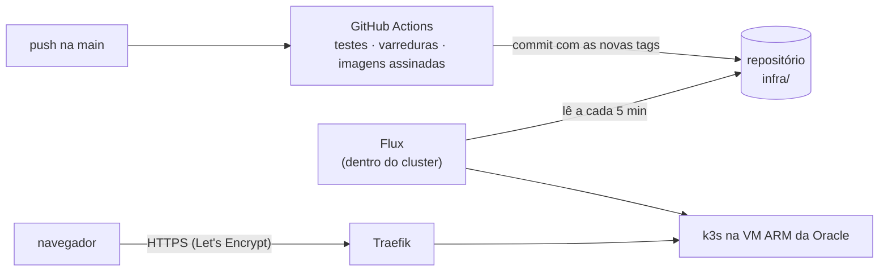

# Infraestrutura: da main para a nuvem

A Vitrine roda num **k3s** (Kubernetes leve) numa VM ARM do nível gratuito da
**Oracle Cloud**, criada com **Terraform**. O deploy é **GitOps**: o **Flux**,
de dentro do cluster, lê esta pasta no repositório e aplica o que mudou. O CI
nunca fala com o cluster, e nenhuma porta de administração fica aberta para a
internet.



| Pasta | O que tem |
|---|---|
| [`kustomization.yaml`](kustomization.yaml) | Ponto de entrada do cluster: domínio, imagens e o que vale para todos os pods |
| [`k8s/`](k8s/) | Manifestos: banco, Kafka, Keycloak, os 5 serviços, painel, Ingress, NetworkPolicies |
| [`terraform/`](terraform/) | Rede, firewall e VM na Oracle Cloud, mais a preparação do servidor (cloud-init) |
| `keycloak/`, `postgres/`, `prometheus/`, `grafana/` | Arquivos usados pelo `docker compose` **e** pelo cluster (uma fonte só) |

## Endereços

Tudo num domínio só, com HTTPS:

| Caminho | Vai para |
|---|---|
| `/` | Painel (nginx) |
| `/api` | Gateway |
| `/auth/realms/vitrine`, `/auth/resources` | Login (Keycloak) |

O console de administração do Keycloak, o realm `master`, o Jaeger e o Mailpit
**não têm rota**: só abrem por um túnel (veja [Administração](#administração)).

## Subir na Oracle Cloud

Pré-requisitos: conta na Oracle Cloud (o nível *Always Free* basta), um domínio,
[Terraform](https://developer.hashicorp.com/terraform/install) 1.9+ e a
[CLI da OCI](https://docs.oracle.com/iaas/Content/API/SDKDocs/cliinstall.htm).

1. **Credenciais da Oracle**, fora do repositório: `oci setup config` cria o
   `~/.oci/config` e a chave da API.
2. **Domínio**: troque `vitrine.example.com` pelo seu em
   [`kustomization.yaml`](kustomization.yaml) (`DOMINIO` e `URL_PUBLICA`) e faça
   commit.
3. **Imagens públicas**: depois do primeiro push na main, o CI publica as 6
   imagens no GitHub Container Registry. Em cada pacote, *Package settings* →
   *Change visibility* → *Public* (o cluster baixa sem credencial).
4. **Criar a VM**:
   ```bash
   cd infra/terraform
   cp terraform.tfvars.example terraform.tfvars   # preencha: região, OCID, chave SSH pública, seu IP
   terraform init
   terraform apply
   ```
5. **DNS**: crie um registro `A` do domínio para o `ip_publico` que o Terraform
   mostrou. Quando o DNS propagar, o cert-manager emite o certificado sozinho.
6. **Deploy contínuo**: em *Settings* → *Secrets and variables* → *Actions* →
   *Variables*, crie `DEPLOY_ATIVO` = `true`. A partir daí, cada push na main
   que passar no CI vira deploy.

A primeira subida leva uns 15 minutos (cloud-init, k3s, cert-manager, Flux e as
aplicações). Para acompanhar: `ssh ubuntu@IP` e
`sudo tail -f /var/log/vitrine-preparo.log`.

> Se o `terraform apply` disser *Out of host capacity*, a Oracle está sem
> máquinas ARM livres naquele domínio de disponibilidade: tente
> `indice_dominio_disponibilidade = 1` (ou 2), ou de novo mais tarde.

## Administração

SSH só a partir do IP em `ip_administracao`, só com chave. Para usar o `kubectl`
do seu computador, um túnel (a porta 6443 nunca fica aberta):

```bash
ssh -N -L 6443:127.0.0.1:6443 ubuntu@IP
```

As telas internas, também por túnel (`sudo kubectl ...` na VM, ou pelo túnel acima):

```bash
kubectl -n vitrine port-forward svc/keycloak 8180:8080   # http://localhost:8180/auth/admin
kubectl -n vitrine port-forward svc/jaeger 16686:16686   # http://localhost:16686
kubectl -n vitrine port-forward svc/mailpit 8025:8025    # http://localhost:8025
```

As senhas foram geradas na própria VM e só existem no cluster. A do admin do
Keycloak:

```bash
sudo kubectl -n vitrine get secret vitrine-segredos -o jsonpath='{.data.KC_SENHA_ADMIN}' | base64 -d
```

## Segurança, camada por camada

| Camada | O que está feito |
|---|---|
| Rede da nuvem | Security list com só 80 e 443 abertos; SSH só do seu IP; firewall da VM também fechado |
| Rede do cluster | NetworkPolicies: tudo negado por padrão; cada serviço só recebe de quem precisa; **nenhum pod sai para a internet** |
| Pods | Perfil *restricted* do Pod Security; sem root; disco somente leitura; sem capacidades; sem token da API do Kubernetes |
| Segredos | Gerados na VM com `openssl rand`; nunca passam pelo Terraform, pelo CI ou pelo repositório; cifrados no banco do k3s |
| Acesso | GitOps: o cluster puxa do repositório, o CI não tem credencial do cluster; console do Keycloak fora da internet |
| HTTPS | Let's Encrypt renovado sozinho; HTTP redireciona para HTTPS; HSTS |
| Cadeia de suprimentos | Actions fixadas por SHA; imagens com SBOM, proveniência e assinatura (cosign); varredura de vulnerabilidades no CI; Dependabot |
| VM | Metadados só na versão 2 (contra SSRF); atualizações de segurança automáticas; SSH sem senha e sem root |

Para conferir a assinatura de uma imagem publicada:

```bash
cosign verify ghcr.io/nicole21carvalho/vitrine-gateway:latest \
  --certificate-identity-regexp 'https://github.com/nicole21carvalho/vitrine/' \
  --certificate-oidc-issuer https://token.actions.githubusercontent.com
```

## Como foi testado

Os mesmos manifestos rodaram num k3s local (mesma versão, dentro do Docker, com
a mesma configuração do Traefik que o cloud-init grava):

- o [teste de ponta a ponta](../scripts/teste_ponta_a_ponta.py) passou inteiro
  (15/15) pelo Ingress com HTTPS: login, saga, compensação, e-mails, limite de
  requisições e rastreamento pelos 5 serviços;
- num navegador de verdade (Playwright): login PKCE pelo `/auth` no mesmo
  endereço, nenhum token guardado no navegador, pedido confirmado, sessão
  retomada ao recarregar, CSP só com `'self'`, HSTS e nenhuma violação de CSP;
- um pod "intruso", sem os rótulos de acesso, não alcançou banco, Kafka,
  Keycloak, serviços internos, actuator nem a internet, só o DNS;
- um pod privilegiado foi recusado na criação pelo perfil *restricted*.

Os manifestos também passam pelo `kubeconform` e o Terraform pelo
`terraform validate` em todo pull request.
